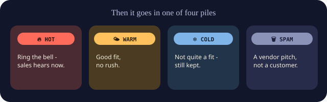

# Lead Router

## The story

### 1. Letters keep arriving.


Meridian Facility Services cleans offices, clinics and schools. All day,
people get in touch. Someone fills in the form on the website. A happy
customer sends a friend their way. A stranger emails out of the blue.
Somebody has to read every one and decide who calls them back.

### 2. A mail carrier brings each one in.


The moment someone clicks Send, a mail carrier picks up the letter and
walks it straight to the sorting desk. Nobody has to go and check the
mailbox. The carrier also waits at the desk, so it can take the answer
back out again.

### 3. Meet Dispatch, the mail sorter.


Dispatch reads every single letter that comes in, and never lets one sit
in the pile unread.

### 4. First, a few quick checks at the door.


Is this a proper letter, with a real email address and an actual
message? Has this exact letter already arrived? (People double-click.
If it's a repeat, Dispatch hands back the answer it already gave and
doesn't bother anyone twice.) Is it obvious junk, like someone selling
website ads? Junk goes straight in the bin without anyone having to
read it.

### 5. Dispatch asks two questions.


Is this really our kind of customer? And how soon do they need us?

### 6. Two helpers do the reading.


Dispatch has an apprentice who lives right there in the office. The
apprentice reads every letter, costs nothing, and is right most of the
time. There's also a senior expert who works from far away and charges
for every letter they read. So the expert only sees two kinds of letter:
the big, exciting ones, because those matter too much to get wrong, and
the ones the apprentice isn't sure about. In testing, that got the
expert's accuracy while sending the expert well under half the letters.

### 7. The rulebook picks the pile.



The helpers only give two scores. They never choose the pile themselves.
A short rulebook on the wall does that. Big fit and real urgency rings
the bell for sales. Good fit with no rush goes to the regular follow-up
pile. A real person who isn't quite the right fit is kept, not thrown
away. A sales pitch goes in the bin. Because the rulebook is written
down, anyone can read it, and changing it doesn't mean retraining
anybody.

### 8. Not sure? Ask a person.


Every helper also says how sure they are. If the answer is shaky,
Dispatch doesn't guess. The letter goes into a "please check" tray and a
real person looks at it first.

### 9. No helpers today? Dispatch still works.


If the apprentice is out sick and the expert can't be reached, Dispatch
doesn't freeze. It pulls out a simple checklist so nothing gets stuck.
The checklist isn't very sharp, so anything it would send to sales goes
to the "please check" tray instead.

### 10. Every decision goes in the ledger.


Every letter gets written down, along with both scores, which pile it
went to, and who decided. So does everything that went wrong, like a
helper not answering or a letter that arrived twice. If someone asks
"why didn't I hear about this one?", the answer is in the book.

### 11. The bell rings.


The carrier takes the decision back out. The right salesperson's phone
lights up within seconds, with a one-line reason they can check at a
glance. The person who wrote in gets a thank-you straight away.

That's the whole idea. If you'd rather click through it,
[Dispatch's Blueprints](https://claude.ai/artifact/TWwGdy9Ui52GNmLZgMQh1x)
follows one letter through every step, with the real code beside each
one. Everything below is how it actually works.

<details>
<summary><strong>Peek at the grown-up version</strong> - what each part of the story actually is in the code</summary>

| In the story | In the code |
|---|---|
| Letters arriving | A form, CRM or email parser POSTing JSON to n8n's `/webhook/lead-intake` |
| The mail carrier | n8n: the Webhook node receives the lead, an HTTP Request node forwards it to `POST /qualify`, and Respond to Webhook answers the sender |
| Dispatch | The FastAPI service (`agent/main.py`) and its LangGraph pipeline (`agent/graph.py`) |
| Proper letter? | Pydantic validation on `LeadIn` (`agent/schema.py`), plus the optional `X-API-Key` check (`agent/security.py`) |
| Already arrived? | Idempotency: a SHA-256 of email + message, backed by a `UNIQUE` column (`agent/store.py`) |
| Obvious junk | The graph's prefilter: empty messages and spam keywords skip the models entirely |
| The two questions | `icp_fit_score` and `urgency_score`, each 0-100, plus a `confidence` |
| The apprentice | A local model (`llama3.1:8b` via Ollama) in `agent/scoring.py::local_score()` |
| The expert | Claude, via `client.messages.parse()` in `llm_score()` |
| Who reads what | `SCORER_MODE=cascade`: Claude is called only when the local model says hot or its confidence is under 0.8 (`business.yaml` under `cascade`) |
| The rulebook | `agent/rules.py::decide_tier()` with thresholds from `business.yaml` |
| "Please check" tray | `needs_review` when confidence is under 0.6, routed to a review Slack channel |
| The checklist | `heuristic_score()`, the last resort when no model answers |
| The ledger | SQLite: the `leads` table, plus `audit_events` for everything rejected, failed or skipped |
| The bell | n8n's Switch node posting to Slack Incoming Webhooks, checked in order: duplicate, review, then tier |

</details>

## How it actually works

This one qualifies and routes inbound leads for a commercial cleaning and facilities contractor. It's split into two halves: n8n handles the plumbing (the webhook, notifications, the CRM handoff), and a Python/LangGraph service does the actual thinking. There's also an eval harness and an ROI dashboard, since a demo GIF doesn't tell you if the thing works or if it's worth the money.

If you wanted to point this at a different business, most of the work is already done. The business profile (who the ideal customer is, the routing rules, the fallback keywords) lives in one plain-language file, [`business.yaml`](business.yaml), instead of being buried in Python. The Slack notifications in the n8n workflow are also real HTTP calls to a webhook URL, not placeholders. See the [go-live checklist](#go-live-checklist) below for what it actually takes to point this at a real client.

```
inbound lead ─▶ n8n webhook ─▶ FastAPI /qualify ─▶ LangGraph agent ─▶ SQLite ─▶ n8n routes by tier
                                                        │
                                                        ├─ prefilter (free, catches obvious spam)
                                                        └─ score (SCORER_MODE):
                                                             claude  - Claude scores every lead
                                                             local   - a local Ollama model scores every lead
                                                             cascade - local first, Claude only for hot or unsure leads
                                                             (keyword heuristic if no model answers)
```

## Why it's built this way

If there's no API key, the heuristic scorer takes over instead of the request just failing. That's the real fallback path this thing runs in production, not a stub, and the eval harness grades it honestly (71.4% overall, worse on the `hot` tier) instead of pretending it's fine.

The graph isn't just a straight chain either. `agent/graph.py` has a real conditional edge: messages that are obviously empty or full of spam keywords never make it to the LLM at all. Don't pay for a frontier model to answer something two lines of Python already knows. The cascade below is the same idea one level up.

The eval set has a couple of traps in it on purpose. One entry in `data/golden_eval_set.json` says "nothing urgent though" — the heuristic scorer keyword-matches on "urgent" and gets it wrong. That's not a bug I quietly fixed; it's the exact kind of mistake the eval harness is supposed to catch, and it's the clearest argument for why the LLM-scored path earns its cost.

## What it does, what's a stub, what's out of scope

**What it actually does today.** Every inbound lead gets a fit score and an urgency score. With an API key those come from Claude; without one (or when the call fails) they come from a keyword checklist. Claude never picks the tier - its output schema doesn't have a tier field. `agent/rules.py` turns the two scores into hot/warm/cold/spam using the thresholds in `business.yaml`, so "what counts as hot" is a config line you can read, not a prompt you hope gets followed. Then:

- If confidence is under `review.min_confidence` (0.6), the lead is flagged `needs_review` and n8n sends it to a review channel instead of routing it. On the heuristic fallback that's every hot and warm lead, on purpose: the checklist never pings sales directly.
- The same email + message submitted twice returns the stored decision without re-scoring it. A `UNIQUE` column backs this up if two copies arrive at the same moment. It only comes back as `duplicate: true` once n8n has confirmed delivery (`POST /leads/{id}/routed`, which sets `routed_at`). A lead that was saved but never delivered, say because n8n timed out, comes back with `duplicate: false` and gets routed on the retry. A rare double ping is better than a lost lead.
- Scoring has a hard 10-second budget (`SCORING_BUDGET_S`), because n8n stops waiting after 15. Each model call gets only what's left of it and is abandoned at the deadline, and Claude is skipped if less than 2 seconds remain. Anything that runs out of time falls back to the checklist, which always goes to review. Eight leads at once now take at most 10.1 s; before this, the slowest took 16.7 s.
- Rejected requests (bad input, bad API key), Claude failures that fell back to the heuristic, crashes, and skipped repeats all go to `audit_events`, readable at `GET /audit`. Successful decisions live in `leads`.
- Requests over 64 KB get a 413 before they're parsed, and each IP gets 120 requests a minute (`MAX_BODY_BYTES`, `RATE_LIMIT_PER_MINUTE`; `agent/limits.py`). Only the first refusal per IP per minute is logged, so a flood can't flood the audit table. Both are in-memory, which is right for one process. With several, set the same limits in the reverse proxy.
- `/docs`, `/redoc` and `/openapi.json` are off unless `ENABLE_API_DOCS=true`.

**The honest numbers.** The golden set is 21 hand-labeled cases. The heuristic gets 71.4% (15/21), and only 1 of 4 hot leads. With the confidence gate on, 12 of the 21 go to human review, and the 9 it auto-routes are all correct. The Claude path gets 90.5% (19/21), and all 4 hot leads. It sends 2 of the 21 to review, and those 2 are exactly its 2 misses, so everything it auto-routes is correct. One miss is the keyword-stuffed price-shopping trap: Claude called it warm instead of cold. The other is a whitespace-only message. The eval grades the scorer on its own, so it skips the graph's prefilter, which in the real pipeline would mark that lead as spam before Claude ever saw it. Run on 2026-11-06, 21 cases. It's a small set, so read it as "clearly better than the heuristic", not as a precise rate.

**A cheap model first, Claude when it matters.** With `SCORER_MODE=cascade`, a local model (`llama3.1:8b` through Ollama, on an RTX 3070) scores every lead for free. Claude is only called if the local model says hot, or its confidence is under 0.8. Hot leads always get a second look because they're rare and they're the expensive ones to get wrong. That rule earned its place in testing. The local model gets 85.7% on its own and finds all 4 hot leads, but it was confidently wrong twice, and both times it had said hot. The cascade matched Claude's 90.5% while calling Claude on 12 of 21 cases, and the eval's threshold sweep shows the same accuracy at 0.5 with only 6 Claude calls. If Ollama is down the lead goes to Claude. If Claude is down the local answer stands. Every failure is written to `audit_events`.

Some caveats on that. The eval scores each model once and simulates the cascade from the stored answers, so trying thresholds is free (`python -m eval.run_eval --reuse-claude`). The Claude answers behind these numbers were rebuilt from an earlier run's printout and are marked `reconstructed`. That run didn't record tokens, so there's no measured dollar figure yet; the next paid run logs real token usage. The local model also takes about 4.5 seconds a lead, which adds to the time n8n waits.

**Reproducibility.** The Claude call doesn't set `temperature=0`, and that's on purpose: current models (including the `claude-opus-5` default here) reject sampling parameters, and SDK 1.x's `messages.parse()` doesn't take them. Two things make results repeatable anyway. The tier is computed deterministically from the scores, and a repeated lead returns its stored decision. Re-scoring the same text from scratch can still produce slightly different scores.

**Still a stub.**
- Cold leads: the n8n "nurture sequence" node is a placeholder Set node. Nobody actually gets enrolled in anything.
- The "CRM": it's the SQLite file. Nothing is written to a real CRM.
- The review queue is a Slack channel (`SLACK_WEBHOOK_REVIEW`), not a tool with approve/reject buttons that feed back into the record.
- The n8n workflow is hand-written JSON that has never been imported into a live n8n.

**Intentionally out of scope.** Per-user auth and roles (there's one shared secret), alerting on leads that stay undelivered (`routed_at` is recorded, but nothing watches it yet), migrations for old databases (reset instead), and a golden set built from a real client's historical leads.

## Quickstart

```bash
python -m venv .venv
source .venv/Scripts/activate        # Windows: .venv\Scripts\activate
pip install -r requirements.txt -r requirements-dev.txt
cp .env.example .env                 # optional: add ANTHROPIC_API_KEY / AGENT_API_KEY

# 1. Run the tests, linter, and type checker (all offline, no API key needed)
pytest -q
ruff check .
mypy agent data eval scripts dashboard

# 2. Start the agent service
uvicorn agent.main:app --reload --env-file .env

# 3. In another terminal, seed 60 days of realistic history. This also wipes
#    and recreates lead_router.db - do it once after pulling, since the table
#    gained columns (needs_review, idempotency_key) and old files won't match.
python -m scripts.seed_history

# 4. Grade the scorer(s) against the golden eval set
python -m eval.run_eval

# 5. Build the ROI dashboard
python -m dashboard.generate_dashboard
# → open dashboard/roi_dashboard.html
```

With no `ANTHROPIC_API_KEY` set, all of this runs fully offline on the heuristic scorer. That's on purpose, so you can walk through the whole pipeline without paying for a single API call. Add a key to `.env` and every new `/qualify` call routes through Claude instead (`agent/scoring.py::llm_score`, using `client.messages.parse` against the `LLMScore` schema in `agent/schema.py`). `seed_history` deliberately ignores `.env` and stays on the free heuristic - it pushes about 1,100 leads through the graph.

## The n8n side

`n8n/lead-intake-workflow.json` is the plumbing: webhook in, call the agent service, route by `tier`, respond to the caller. The Switch checks two things before the tier: a repeat lead that was already delivered (`duplicate`) goes to a no-op node, and a low-confidence one (`needs_review`) goes to a review channel. After that, the hot and warm branches post to real Slack Incoming Webhooks (an actual `POST` with a formatted message, not a placeholder). Cold stays a labeled placeholder, since nurture tooling is different for every client and there's no point faking one. Spam is a dead end on purpose, already fully handled by the audit log. Every branch ends at "Mark routed", which tells the agent the lead was delivered, and the call to the agent retries up to three times. A timed-out lead gets routed on the retry instead of being lost.

Bring it up with:

```bash
docker compose up -d n8n     # http://localhost:5678
```

Then import `n8n/lead-intake-workflow.json` (Workflows → Import from File) and point the HTTP Request node at wherever `agent/main.py` is actually running (`host.docker.internal:8000` by default for local dev).

One honest note: this workflow JSON was hand-written against n8n's documented node shapes and is valid JSON, but it wasn't live-imported in this session. Docker Desktop wasn't running here, and a broken local `npx` environment variable blocked the fallback check too. Import it yourself and fix whatever n8n's UI flags on first open (most likely node `typeVersion` drift against whatever version you're running) before you treat it as production-ready.

## Security

This got an actual pass, not just a glance. Here's what came up and what I did about it:

- **Every SQL query is parameterized** (`agent/store.py`). `tier` and `limit` come from a caller-supplied query parameter, but they're always passed as bound values, never string-formatted into SQL.
- **Every field on `LeadIn` has bounds** (`agent/schema.py`). `email` is validated as a real address (`EmailStr`), and `message` is capped at 5,000 characters. `POST /qualify` has no auth by default, so without that cap someone could submit a huge message and force every LLM-scored request to burn way more tokens, and money, than a real lead ever would.
- **Shared-secret auth is optional** (`agent/security.py`). It's off by default, since local dev and the test suite need it off, and you turn it on by setting `AGENT_API_KEY` and passing a matching `X-API-Key` header. The check uses `secrets.compare_digest()` instead of `==`, so it doesn't leak timing information about a partially-correct key. It compares bytes, because comparing strings crashed on a non-ASCII key (found in the 2026-11-06 attack, see [SECURITY_FINDINGS.md](SECURITY_FINDINGS.md)).
- **`GET /leads`'s `limit` is now capped at 500.** It used to be unbounded, which meant any caller could force a much bigger response or table scan than a dashboard, or a person, would ever need.
- **LLM failures are logged instead of silently swallowed.** The original code had a bare `except Exception: pass` in `agent/scoring.py`, which hid real problems (an expired key, a billing block, an outage) behind what looked like normal heuristic-mode behavior. Now there's a most-specific-first exception chain — auth error, rate limit, API error, connection error, other — and each one gets logged with what actually happened before the code falls back.
- **Dashboard tooltips build DOM nodes with `textContent`, not `innerHTML`.** Every value in them is server-generated and safe right now, but a tooltip is exactly the kind of place someone adds a raw field later (a company name, a message snippet) without thinking about XSS, so it's written the safe way from the start.
- **What's intentionally missing:** per-user auth, audit trails beyond the SQLite log, and approval gates before a write action. That belongs in a separate project, not this one. The shared secret above is a floor, not a ceiling.

## Go-live checklist

Here's the actual short list to point the agent at a real business. None of it touches Python:

1. **Edit `business.yaml`.** Swap in the real business name, the ideal-customer description, the routing rules, and the fallback keyword lists. It's plain YAML with comments explaining each field. `agent/icp.py` loads it at startup, and everything downstream (the LLM prompt, the offline fallback, the dashboard title) picks it up automatically.
2. **Create three Slack Incoming Webhook URLs** (or fewer, reused). Takes under 2 minutes at [api.slack.com/apps](https://api.slack.com/apps) → your app → Incoming Webhooks → Add New Webhook. Put them in `.env` as `SLACK_WEBHOOK_HOT` / `SLACK_WEBHOOK_WARM` / `SLACK_WEBHOOK_REVIEW` (see `.env.example`).
3. **Point the real form at the webhook.** Swap out `data/synthetic_leads.py` for whatever the client's actual site or CRM sends, posting to n8n's `/webhook/lead-intake` endpoint.
4. **Add `ANTHROPIC_API_KEY`** if you want Claude doing the scoring instead of the 71%-accurate heuristic fallback (Claude scored 90.5% on the same golden set). Real client revenue decisions deserve the real scorer.

Two more things worth doing before this handles real money, even though they won't stop it from running:

- **Re-time `MANUAL_MINUTES_PER_LEAD`** in `dashboard/generate_dashboard.py` against how long the client's team actually takes today. Don't present the default 6-minute guess as a measured fact.
- **Re-run `eval/run_eval.py`** against a golden set built from the client's real historical leads, not `data/golden_eval_set.json` (which is written for the example business shipped here), before trusting the tier assignments with real accounts.

## Layout

```
business.yaml   the business profile — edit this, not Python, to go live for a new client
agent/          FastAPI service + LangGraph orchestration + scoring + auth + SQLite store
data/           synthetic lead generator + hand-labeled golden eval set
eval/           the eval harness (every scorer graded on the same hand-labeled set)
scripts/        seed_history.py — backfills realistic history for the dashboard
dashboard/      generate_dashboard.py — the actual ROI deliverable
n8n/            the importable workflow (webhook → agent → real Slack notifications → route)
tests/          offline pytest suite (no network calls)
pyproject.toml  ruff + mypy config — both run clean; see the Security section for what they caught
```
